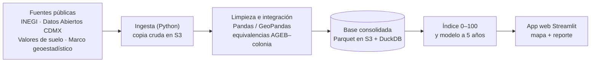

# SOW: Índice de potencial de plusvalía CDMX

**Consultora:** GeoValor Analítica S.C.

**Cliente:** UrbanaData Consultoría Inmobiliaria (contacto: Juan Reyes)

**Respuesta al RFP del:** 07/10/2026

**Versión:** 1.1

**Vigencia del proyecto:** 15/10/2026 al 27/11/2026 (6 semanas)

**Equipo:**

* Joshua Rodríguez Zamora, Ing. en Computación — Project Manager (PM)

* Laura Reyes Carrillo, Ing. en Computación — Data Scientist / Machine Learning Engineer

* Francisco Javier Pérez Nava, Ing. en Computación — Data Engineer

* Héctor Manuel Salazar Rubí, Ing. en Computación — GIS Developer / Backend Engineer

* Brenda Berenice Cornejo Díaz, Ing. en Computación — Frontend Developer / QA Engineer

## 1. Resumen ejecutivo

UrbanaData necesita comparar colonias de la CDMX con datos y no solo con experiencia. Vamos a juntar datos públicos de INEGI, Datos Abiertos CDMX y valores de suelo en una sola base organizada por colonia. Con ella calcularemos un índice de potencial de plusvalía de 0 a 100 y una estimación de cómo podría cambiar el valor en cinco años. Todo se verá en un mapa interactivo y se explicará en un reporte final. Entregamos del 15 de octubre al 27 de noviembre de 2026, por un total estimado de \$128,040 MXN en horas de equipo, con \$0 MXN en datos, licencias y nube.

## 2. Alcance

El proyecto cubre las 16 alcaldías de la CDMX con la colonia como unidad principal de análisis, siempre que haya datos públicos confiables.

**Dentro de alcance:**

* Inventario, evaluación y descarga de fuentes públicas (INEGI, Datos Abiertos CDMX, valores catastrales de suelo, marco geoestadístico).

* Pipeline reproducible de ingesta, limpieza y transformación en Python.

* Tabla de equivalencias AGEB–colonia–alcaldía para unir fuentes con distinta geografía.

* Base consolidada por colonia con variables sociodemográficas, urbanas e inmobiliarias.

* Análisis exploratorio de factores asociados al cambio de valor.

* Índice de potencial de plusvalía (0–100) por colonia.

* Modelo predictivo del cambio de valor a 5 años con métricas de validación.

* Aplicación web sencilla (Streamlit) con el mapa interactivo para consultar y comparar colonias, publicada con recursos gratuitos.

* Pruebas automatizadas del código y validaciones de calidad de los datos.

* Reporte final con resultados, fuentes, criterios, supuestos y limitaciones, más los ADR del proyecto.

**Fuera de alcance:**

* Plataforma de compra-venta de inmuebles: el RFP la excluye; el objetivo es analítico.

* Precio exacto de cada inmueble: los datos públicos no tienen ese detalle; estimamos a nivel colonia.

* Recomendaciones financieras personalizadas o garantías de plusvalía: requieren asesoría regulada y el futuro del mercado es incierto.

* Zonas fuera de la CDMX: el RFP limita esta primera versión a la ciudad.

* Compra de datos privados o licencias de portales inmobiliarios: el presupuesto para datos es \$0 MXN.

* Scraping de portales inmobiliarios: sus términos de uso suelen prohibirlo y no ofrecen historia.

* Cuentas de usuario, inicio de sesión o app móvil: no aportan a la pregunta del RFP y no caben en 6 semanas.

* Operación y mantenimiento después del 27/11/2026: se cotizaría aparte.

* Datos personales: no se recolectan ni almacenan.

## 3. Entregables y criterios de aceptación

Ocho entregables, cada uno con una prueba que el cliente puede verificar.

| \# | Entregable | Criterio de aceptación | Hito |
| ----- | ----- | ----- | ----- |
| E1 | Inventario y diccionario de datos | Cada fuente documenta URL, licencia, cobertura temporal, granularidad geográfica y frecuencia de actualización; cada variable tiene definición y unidad | 1 |
| E2 | Pipeline de ingesta y limpieza | Un solo comando regenera la base desde cero; incluye reporte de faltantes, duplicados e inconsistencias por fuente | 2 |
| E3 | Base consolidada por colonia | Consulta SQL devuelve todas las variables por colonia y año; al menos 90% de las colonias de la CDMX con variables clave completas | 2 |
| E4 | Análisis de factores | Notebook con correlaciones e importancia de variables frente al cambio de valor, con conclusiones en lenguaje simple | 3 |
| E5 | Índice de potencial de plusvalía | Cada colonia analizada tiene puntuación 0–100 y ranking; pesos y fórmula documentados y aprobados por el cliente | 3 |
| E6 | Modelo predictivo a 5 años | Estimación de cambio de valor por colonia; reporta MAE, RMSE y R² en validación temporal y supera a un modelo base ingenuo | 4 |
| E7 | Aplicación web con mapa interactivo | Muestra índice y estimación por colonia, permite filtrar por alcaldía y comparar al menos 2 colonias lado a lado; accesible por URL pública | 5 |
| E8 | Reporte final y ADR | Explica resultados, limitaciones, fuentes, criterios y supuestos; incluye leyenda de que no es asesoría financiera | 5 |

## 4. Trazabilidad con el RFP

Las seis necesidades quedan cubiertas; N2 y N5 son parciales por la poca historia pública de precios.

| Necesidad del RFP | Entregable(s) que la cubre(n) | Estado |
| ----- | ----- | ----- |
| N1 Integrar información de varias fuentes | E1, E2, E3 | Cubierta |
| N2 Comportamiento histórico del valor | E3, E4 | Parcial: la historia depende de valores catastrales anuales y censos 2010 y 2020 |
| N3 Zonas con características de crecimiento | E4, E5 | Cubierta |
| N4 Índice de potencial de plusvalía | E5 | Cubierta |
| N5 Estimación a 5 años con métricas | E6 | Parcial: estimación por colonia, no por inmueble, con intervalo de incertidumbre |
| N6 Visualización o mapa | E7 | Cubierta |

## 5. Enfoque técnico (alto nivel)

Un pipeline en Python lleva los datos públicos a una base única por colonia, de donde salen el índice, el modelo y el mapa.

* **Unidad geográfica: colonia.** Es como piensan los inversionistas; los datos de AGEB se reparten a colonias por intersección espacial ponderada por población ([ADR-02](../adr/ADR-02-unidad-geografica.md)).

* **Variable objetivo: valor unitario de suelo catastral por colonia.** Es la única serie pública anual por colonia; el precio comercial no tiene historia abierta ([ADR-03](../adr/ADR-03-variable-objetivo.md)).

* **Almacenamiento: S3 para crudos y Parquet, DuckDB para consultas SQL.** Cuesta \$0 y no requiere servidor de base de datos ([ADR-01](../adr/ADR-01-almacenamiento.md)).

* **Índice:** variables normalizadas de 0 a 100; pesos iniciales por PCA, ajustados con el cliente ([ADR-04](../adr/ADR-04-metodo-indice.md)).

* **Modelo:** regresión lineal como base explicable y Gradient Boosting como alternativa; validación temporal entrenando con años anteriores y probando con los más recientes ([ADR-05](../adr/ADR-05-modelo-validacion.md)).

* **Visualización:** aplicación web en Streamlit con mapa coroplético (Folium), sin licencias.

*Todos los ADR están en la carpeta [`Doc/adr`](../adr/).*

## 6. Plan por hitos

Seis hitos en 6 semanas y 300 horas de equipo; cada hito cierra en viernes con revisión del cliente.

| Hito | Qué se entrega | Evidencia | Fecha | Horas |
| ----- | ----- | ----- | ----- | ----- |
| 0 Arranque | Plan de trabajo, repositorio, ADR iniciales, acuerdo de unidad geográfica | Acta de kickoff firmada y repositorio con estructura base | 16/10/2026 | 15 |
| 1 Inventario y adquisición | E1 y datos crudos descargados | Diccionario de datos y carpeta raw con todas las fuentes | 23/10/2026 | 50 |
| 2 Integración y limpieza | E2 y E3 | Pipeline corre de punta a punta; reporte de calidad; consulta SQL de prueba | 06/11/2026 | 80 |
| 3 Indicadores e índice | E4 y E5 | Notebook de factores y ranking de colonias con pesos aprobados | 13/11/2026 | 50 |
| 4 Modelo predictivo | E6 | Reporte de validación con MAE, RMSE y R² contra modelo base | 20/11/2026 | 55 |
| 5 Visualización y cierre | E7 y E8 | App publicada, reporte final y presentación al cliente | 27/11/2026 | 50 |
| **Total** |  |  |  | **300** |

*Nota: El lunes 16/11/2026 es día feriado; el hito 4 ya considera esa semana de cuatro días.*

## 7. Equipo y responsabilidades

Joshua Rodríguez es el único punto de contacto con UrbanaData; el resto del equipo le reporta a él.

| Rol | Nombre | Responsabilidad principal | Reporta a |
| ----- | ----- | ----- | ----- |
| Project Manager (PM) | Joshua Rodríguez Zamora | Gestión ágil del proyecto, mitigación de riesgos, control de versiones/cambios y comunicación con el cliente. | Juan Reyes (UrbanaData) |
| Data Scientist / ML Engineer | Laura Reyes Carrillo | Diseño del algoritmo del índice, *feature engineering* y entrenamiento/validación de modelos de Machine Learning. | Joshua Rodríguez |
| Data Engineer | Francisco Javier Pérez Nava | Diseño de arquitectura de datos (AWS S3/DuckDB), orquestación de pipelines ETL y optimización del almacén de datos. | Joshua Rodríguez |
| GIS Developer / Backend Engineer | Héctor Manuel Salazar Rubí | Desarrollo del backend geoespacial, procesamiento vectorial y co-desarrollo con Laura para extraer *features* espaciales que potencien el modelo predictivo. | Joshua Rodríguez |
| Frontend Developer / QA Engineer | Brenda Berenice Cornejo Díaz | Desarrollo de la web app y mapa interactivo (UI/UX), despliegue y diseño de pruebas automatizadas para validar código y datos. | Joshua Rodríguez |

## 8. Supuestos y dependencias del cliente

El plan depende de que UrbanaData apruebe pesos y entregables a tiempo y de que las fuentes públicas sigan disponibles.

**Supuestos:**

* Las fuentes públicas (INEGI, Datos Abiertos CDMX, valores unitarios de suelo publicados en la Gaceta Oficial) siguen accesibles y gratuitas durante el proyecto.

* La colonia es la unidad de análisis; si en el hito 1 la cobertura no alcanza, cambiamos a alcaldía (menos detalle) o a AGEB (más detalle), con aviso al cliente.

* El valor catastral de suelo por colonia sirve como aproximación del valor de mercado, porque no hay una serie pública de precios comerciales por colonia.

* El equipo dedica 10 horas por persona a la semana (5 personas × 10 h × 6 semanas = 300 h).

* Las cuentas de AWS Academy o la capa gratuita de AWS alcanzan para almacenamiento y cómputo.

**Dependencias del cliente:**

* Juan Reyes asiste a la revisión semanal de 30 minutos cada viernes.

* Aprueba o comenta cada hito en un máximo de 3 días hábiles.

* Valida los pesos del índice antes del 11/11/2026.

* Comparte cualquier dato propio o criterio de inversión que quiera incluir antes del 20/10/2026.

**Datos del RFP que no cuadran:**

* La pregunta principal habla de zonas "rentables", pero se excluyen recomendaciones financieras; interpretamos "rentable" como mayor potencial de plusvalía, sin calcular rendimientos ni rentas.

* N2 pide historia "suficiente" sin definir cuánta; proponemos al menos 5 años de serie de valores de suelo.

* N5 pide "métricas de validación" sin fijar una meta; proponemos que el modelo supere a un modelo base ingenuo (el valor crece igual que su promedio histórico).

* El RFP lista precios de venta y precio por m² como fuentes, pero no existe una fuente pública gratuita con historia por colonia; usamos valores catastrales (ver ADR-03).

* El censo a nivel AGEB solo existe para 2010 y 2020, lo que limita la historia sociodemográfica a dos cortes.

## 9. Riesgos

El riesgo principal es la poca historia pública de precios; por eso el modelo trabaja con valores catastrales y reporta incertidumbre.

| Riesgo | Probabilidad | Impacto | Qué haremos |
| ----- | ----- | ----- | ----- |
| No hay serie histórica pública de precios de mercado por colonia | Alta | Alto | Usar valores unitarios de suelo catastrales como variable objetivo y documentarlo como limitación |
| Las colonias, AGEB y códigos postales no coinciden | Alta | Medio | Tabla de equivalencias por intersección espacial ponderada por población (ADR-02) |
| Plazo corto de 6 semanas | Media | Alto | Priorizar E1–E6; si hay retraso, la app se reduce a un mapa estático y se avisa al cliente |
| Cambia el formato o la URL de una fuente pública | Media | Alto | Guardar copia cruda versionada en S3 y validar esquema al ingerir |
| Muchos valores faltantes en permisos de construcción | Media | Medio | Imputar a nivel alcaldía, marcar el dato imputado y medir su efecto en el índice |
| Modelo con poca precisión por pocos años de datos | Media | Alto | Comparar contra modelo base, reportar intervalos y presentar la estimación como rangos |
| El cliente tarda en aprobar los pesos del índice | Media | Medio | Proponer pesos por defecto con PCA y fecha límite de aprobación el 11/11/2026 |
| Se agota el crédito o la capa gratuita de AWS | Baja | Medio | Configurar alerta de presupuesto en AWS; procesar localmente con DuckDB y usar S3 solo para almacenamiento |
| Ausencia de un integrante del equipo | Baja | Medio | Documentar todo en el repositorio y asignar un respaldo por rol |

## 10. Presupuesto

El costo total estimado es \$128,040 MXN, todo en horas de equipo; datos, licencias y AWS cuestan \$0 MXN.

| Concepto | Horas | Tarifa MXN/h | Subtotal MXN |
| ----- | ----- | ----- | ----- |
| Project Manager (PM) | 48 | 450 | 21,600 |
| Data Scientist / ML Engineer | 66 | 400 | 26,400 |
| Data Engineer | 66 | 400 | 26,400 |
| GIS Developer / Backend Engineer | 60 | 350 | 21,000 |
| Frontend Developer / QA Engineer | 60 | 350 | 21,000 |
| Subtotal equipo | 300 |  | 116,400 |
| Colchón de imprevistos (10%) |  |  | 11,640 |
| Costo estimado de AWS (AWS Academy / capa gratuita) |  |  | 0 |
| **Total** |  |  | **128,040** |

El RFP fija \$0 MXN para adquisición de datos y licencias, y \$0 MXN de operación mensual. Cumplimos ambos: solo usamos datos abiertos, software libre (Python, GeoPandas, DuckDB, Folium, Streamlit) y recursos gratuitos de AWS. El RFP no pone tope a las horas de equipo, así que no fue necesario recortar alcance.

## 11. Control de cambios y comunicación

Todo cambio se pide por escrito y lo aprueban Juan Reyes y Joshua Rodríguez antes de trabajarlo.

1. El cliente envía la solicitud por correo o en el canal del proyecto, describiendo qué quiere y para qué.

2. El Project Manager evalúa impacto en horas, fechas y costo en máximo 2 días hábiles.

3. Cambios de hasta 8 horas se absorben con el colchón de imprevistos; cambios mayores se cotizan aparte o se cambian por otro elemento del alcance.

4. Juan Reyes (UrbanaData) y Joshua Rodríguez (GeoValor) firman la solicitud; sin firma no se trabaja.

5. El cambio aprobado se registra en la bitácora de cambios del repositorio (*issues* de GitHub) y, si afecta decisiones técnicas, en un ADR.

**Comunicación:** revisión semanal de 30 minutos cada viernes, reporte de avance por escrito el mismo día y canal de mensajería con respuesta en menos de 24 horas hábiles.

## 12. Aceptación y pagos

Un hito se da por terminado cuando su evidencia cumple el criterio de aceptación y el cliente lo aprueba por escrito.

El cliente tiene 3 días hábiles para revisar cada hito. Si encuentra fallas, las enumera por escrito y el equipo las corrige en 3 días hábiles. Si no responde en ese plazo, el hito se considera aceptado.

| Hito | Porcentaje | Monto MXN |
| ----- | ----- | ----- |
| 0 Arranque | 15% | 19,206 |
| 1 Inventario y adquisición | 15% | 19,206 |
| 2 Integración y limpieza | 20% | 25,608 |
| 3 Indicadores e índice | 15% | 19,206 |
| 4 Modelo predictivo | 15% | 19,206 |
| 5 Visualización y cierre | 20% | 25,608 |
| **Total** | **100%** | **128,040** |

El proyecto termina al aceptarse el hito 5, a más tardar el 27/11/2026.
