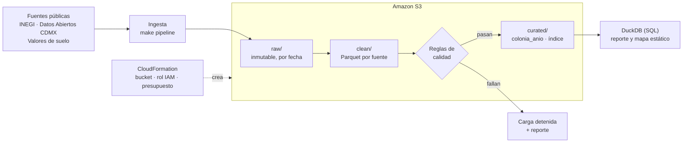

# SOW: Índice de potencial de plusvalía CDMX

**Consultora:** GeoValor Analítica S.C.

**Cliente:** UrbanaData Consultoría Inmobiliaria (contacto: Juan Reyes)

**Respuesta al RFP del:** 07/10/2026

**Versión:** 2.0 (22/10/2026)

**Vigencia del proyecto:** 15/10/2026 al 27/11/2026 (6 semanas)

**Equipo:**

* Joshua Rodríguez Zamora, Ing. en Computación — Project Manager (PM)

* Francisco Javier Pérez Nava, Ing. en Computación — Data Engineer de ingesta y almacenamiento

* Héctor Manuel Salazar Rubí, Ing. en Computación — Data Engineer de transformación

* Laura Reyes Carrillo, Ing. en Computación — Analista de calidad y gobierno de datos

* Brenda Berenice Cornejo Díaz, Ing. en Computación — QA de datos y pruebas del pipeline

## Cambios en esta versión

La v2 convierte la propuesta en un proyecto de ingeniería de datos: el producto son datos confiables, disponibles y documentados, no un modelo ni una aplicación.

| Qué cambió | v1.1 | v2.0 | Por qué |
|---|---|---|---|
| Modelo predictivo | Entregable comprometido (Gradient Boosting, MAE, RMSE, R²) | Opcional, sólo si sobra tiempo | 5 años de valores catastrales y 2 censos no alcanzan para un modelo serio; el esfuerzo rendía poco |
| Índice | Pesos por PCA | Fórmula simple con pesos explícitos en `config/indice.yaml` | Se explica en un minuto y el cliente ajusta pesos sin tocar código |
| Aplicación web (E7) | Streamlit con URL pública | Se elimina; la tabla curada consultable con SQL es el producto | Es desarrollo de aplicaciones y alojarla en AWS no está garantizado en la capa gratuita |
| Infraestructura | Creada a mano | Plantilla de CloudFormation (`infra/template.yaml`) | Reproducible: se despliega y se elimina con un comando |
| Calidad de datos | "Reporte de faltantes e inconsistencias" | 8 reglas con umbral; las bloqueantes detienen la carga | Una intención no se puede verificar; una regla sí |
| Gobierno de datos | No existía | Linaje, dueño por capa, versionado de `raw/` e idempotencia | Responde "¿de dónde salió este número?" en un minuto |
| Unidad geográfica | "Si no alcanza, bajamos de nivel" | Criterio medible: menos de 80% de colonias empatadas → alcaldía | La geografía es el riesgo técnico más grande |
| Cuenta de AWS | "AWS Academy o capa gratuita" | Cuenta propia con capa gratuita | Son entornos distintos; Academy no permite crear roles IAM ni presupuestos |
| Roles | Data Scientist, GIS, Frontend | Dos Data Engineers, calidad y gobierno, QA de datos | Cada rol corresponde a trabajo real de un equipo de datos |

## 1. Resumen ejecutivo

UrbanaData necesita comparar colonias de la CDMX con datos y no sólo con experiencia. Vamos a construir un pipeline que descarga datos públicos de INEGI, Datos Abiertos CDMX y valores de suelo, los limpia, los valida con reglas de calidad y los publica en una base por colonia consultable con SQL. Sobre esa base calculamos un índice de potencial de plusvalía de 0 a 100 con una fórmula simple y documentada. Todo corre en AWS con infraestructura como código y costo de \$0 MXN. Entregamos del 15 de octubre al 27 de noviembre de 2026, por un total estimado de \$128,040 MXN en horas de equipo.

## 2. Alcance

El proyecto cubre las 16 alcaldías de la CDMX con la colonia como unidad de análisis, sujeta al criterio de la sección 5.

**Dentro de alcance:**

* Inventario de fuentes públicas, diccionario de datos y tabla de linaje.

* Infraestructura en AWS definida en CloudFormation: bucket S3 con tres zonas (`raw/`, `clean/`, `curated/`), rol IAM mínimo para el pipeline y alerta de presupuesto.

* Pipeline reproducible e idempotente de ingesta, limpieza y transformación en Python, ejecutado con un solo comando.

* Reglas de calidad automatizadas que detienen o marcan la carga.

* Tabla de equivalencias AGEB–colonia–alcaldía.

* Base curada por colonia y año en Parquet, consultable con SQL (DuckDB).

* Índice de potencial de plusvalía (0–100) con pesos configurables.

* Reporte final con resultados, un mapa estático o notebook, fuentes, criterios, supuestos y limitaciones.

**Fuera de alcance:**

* Modelo predictivo como entregable comprometido: los datos públicos disponibles no bastan para un modelo confiable; queda como extra opcional.

* Aplicación web interactiva con URL pública: es desarrollo de aplicaciones y alojarla en AWS no cabe con seguridad en la capa gratuita; las consultas SQL y el mapa estático cubren N6.

* Amazon Athena y AWS Glue: cobran por uso sin capa gratuita y el cliente pide costo \$0.

* Orquestadores (Airflow, Step Functions): los datos cambian pocas veces al año; un comando documentado basta (ADR-06).

* Plataforma de compra-venta de inmuebles: el RFP la excluye.

* Precio exacto de cada inmueble: los datos públicos no tienen ese detalle.

* Recomendaciones financieras o garantías de plusvalía: requieren asesoría regulada.

* Zonas fuera de la CDMX: el RFP limita esta versión a la ciudad.

* Compra de datos o scraping de portales inmobiliarios: presupuesto de \$0 y términos de uso que lo prohíben.

* Datos personales: no se recolectan ni almacenan.

* Operación después del 27/11/2026: se cotizaría aparte.

## 3. Entregables y criterios de aceptación

Ocho entregables de ingeniería de datos, cada uno con una prueba que el cliente puede verificar.

| \# | Entregable | Criterio de aceptación | Hito |
| ----- | ----- | ----- | ----- |
| E1 | Inventario, diccionario y linaje | Cada fuente documenta URL, licencia, cobertura temporal, granularidad y frecuencia; cada variable tiene definición y unidad; la tabla de linaje lleva cada columna curada hasta su fuente | 1 |
| E2 | Infraestructura como código | `infra/template.yaml` crea el bucket, el rol IAM y la alerta de presupuesto en un solo despliegue; se elimina con un comando; costo mensual de \$0 | 1 |
| E3 | Pipeline de ingesta y transformación | `make pipeline` regenera `clean/` y `curated/` desde `raw/`; **correrlo dos veces da el mismo resultado sin duplicar filas**; cada descarga queda en `raw/<fuente>/<AAAA-MM-DD>/` y nunca se modifica | 2 |
| E4 | Reglas de calidad automatizadas | Las 8 reglas de la sección 5 corren en cada ejecución; una regla bloqueante que falla detiene la publicación en `curated/`; se genera un reporte de calidad por corrida | 2 |
| E5 | Tabla de equivalencias geográficas | Relaciona AGEB, colonia y alcaldía; documenta el porcentaje de colonias empatadas y la decisión de unidad tomada con el criterio de la sección 5 | 2 |
| E6 | Base curada consultable con SQL | Tabla `colonia_anio` en Parquet; al menos 90% de las colonias con variables clave; 5 consultas SQL de ejemplo en DuckDB que responden preguntas del cliente | 3 |
| E7 | Índice de potencial de plusvalía | Cada colonia tiene puntuación 0–100 y ranking en `curated/`; los pesos viven en `config/indice.yaml` y cambiarlos recalcula el índice sin tocar código | 4 |
| E8 | Reporte final y documentación | README con arquitectura y cómo correrlo; reporte con resultados, mapa estático o notebook, limitaciones y leyenda de que no es asesoría financiera | 5 |

**Opcional, si sobra tiempo:** regresión lineal simple de la tendencia a 5 años por colonia, comparada contra un modelo base ingenuo.

## 4. Trazabilidad con el RFP

Cuatro necesidades quedan cubiertas; N2 y N5 son parciales por la poca historia pública de precios.

| Necesidad del RFP | Entregable(s) que la cubre(n) | Estado |
| ----- | ----- | ----- |
| N1 Integrar información de varias fuentes | E1, E3, E5, E6 | Cubierta |
| N2 Comportamiento histórico del valor | E3, E6 | Parcial: la historia depende de valores catastrales anuales y censos 2010 y 2020 |
| N3 Zonas con características de crecimiento | E6, E7 | Cubierta |
| N4 Índice de potencial de plusvalía | E7 | Cubierta |
| N5 Estimación a 5 años con métricas | E6 (tendencia histórica por colonia); modelo opcional | Parcial: se entrega la tasa de cambio histórica; la predicción con métricas es un extra no comprometido |
| N6 Visualización o mapa | E6, E8 | Cubierta con consultas SQL y mapa estático; sin aplicación interactiva |

## 5. Enfoque técnico (alto nivel)

Un pipeline en Python, ejecutado con un comando, mueve los datos públicos por tres zonas de S3 y sólo publica en `curated/` lo que pasa las reglas de calidad.

* **Almacenamiento:** S3 con tres zonas, Parquet y DuckDB para SQL. Costo \$0 y sin servidores ([ADR-01](../adr/ADR-01-almacenamiento.md)).

* **Infraestructura como código:** CloudFormation crea todo lo de AWS; nada se configura a mano en la consola ([ADR-01](../adr/ADR-01-almacenamiento.md), [`infra/template.yaml`](../../infra/template.yaml)).

* **Ejecución:** un comando manual documentado (`make pipeline`), porque los datos cambian pocas veces al año ([ADR-06](../adr/ADR-06-ejecucion-pipeline.md)).

* **Unidad geográfica:** colonia, con reparto desde AGEB ponderado por población y un criterio medible para cambiar de nivel ([ADR-02](../adr/ADR-02-unidad-geografica.md)).

* **Valor de referencia:** valor unitario de suelo catastral por colonia ([ADR-03](../adr/ADR-03-variable-objetivo.md)).

* **Índice:** variables normalizadas × pesos explícitos en un archivo de configuración ([ADR-04](../adr/ADR-04-metodo-indice.md)).

* **Modelo predictivo:** opcional ([ADR-05](../adr/ADR-05-modelo-validacion.md)).

### Reglas de calidad

Cada regla corre en cada ejecución. Las bloqueantes detienen la publicación en `curated/`; las de advertencia marcan el dato y quedan en el reporte.

| # | Regla | Umbral | Tipo |
|---|---|---|---|
| R1 | La llave `colonia_id + anio` es única en `colonia_anio` | 0 duplicados | Bloqueante |
| R2 | El valor catastral de suelo es mayor que 0 y no es nulo | 100% de filas | Bloqueante |
| R3 | Cada fuente llega con las columnas y tipos esperados | 100% de columnas | Bloqueante |
| R4 | Las geometrías de colonias y AGEB son válidas después de la limpieza | 100% | Bloqueante |
| R5 | La población repartida de AGEB a colonias suma lo mismo que el total de cada alcaldía | ±1% | Bloqueante |
| R6 | Colonias con todas las variables clave | Al menos 90% | Bloqueante |
| R7 | Los años están dentro del rango esperado (2010 a 2026) | 100% | Bloqueante |
| R8 | El cambio anual del valor catastral de una colonia está entre −50% y +100% | Fuera de rango se marca | Advertencia |

### Gobierno de datos

| Zona | Quién escribe | Regla | Versión |
|---|---|---|---|
| `raw/` | Sólo la ingesta | Nunca se modifica ni se borra | Carpeta por fecha de descarga: `raw/inegi_censo/2026-10-23/` |
| `clean/` | La transformación | Se regenera completa desde `raw/` | Ligada a la fecha de `raw/` que la generó |
| `curated/` | La transformación, sólo si pasan las reglas bloqueantes | Se sobrescribe, nunca se agrega | Ligada a la corrida y su reporte de calidad |

El linaje completo y el detalle de idempotencia están en [`docs/datos/gobierno-de-datos.md`](../datos/gobierno-de-datos.md).

### Criterio de unidad geográfica

1. Al inicio del hito 1, antes de construir nada, buscamos una tabla pública de equivalencias o una llave común entre INEGI y Datos Abiertos CDMX.
2. Al cierre del hito 1 (23/10/2026) medimos qué porcentaje de las colonias del catálogo se empata con al menos una AGEB.
3. **Si se empata 80% o más, trabajamos por colonia. Si es menos de 80%, el proyecto pasa a nivel alcaldía** y se avisa al cliente con esa evidencia.

## 6. Plan por hitos

Seis hitos en 6 semanas y 300 horas de equipo; cada hito cierra en viernes con revisión del cliente.

| Hito | Qué se entrega | Evidencia | Fecha | Horas |
| ----- | ----- | ----- | ----- | ----- |
| 0 Arranque | Plan de trabajo, repositorio, ADR iniciales | Acta de kickoff y repositorio con estructura base | 16/10/2026 | 15 |
| 1 Inventario e infraestructura | E1, E2 y prueba de empate geográfico | Diccionario y linaje; stack de CloudFormation desplegado; porcentaje de colonias empatadas | 23/10/2026 | 55 |
| 2 Pipeline y calidad | E3, E4 y E5 | `make pipeline` corre dos veces con el mismo resultado; reporte de calidad; tabla de equivalencias | 06/11/2026 | 100 |
| 3 Base curada | E6 | Tabla `colonia_anio` en `curated/` y 5 consultas SQL de ejemplo | 13/11/2026 | 45 |
| 4 Índice | E7 (y modelo opcional si sobra tiempo) | Ranking de colonias; recálculo al cambiar `config/indice.yaml` | 20/11/2026 | 40 |
| 5 Documentación y cierre | E8 | README, reporte final, mapa estático y presentación al cliente | 27/11/2026 | 45 |
| **Total** |  |  |  | **300** |

*Nota: El lunes 16/11/2026 es día feriado; el hito 4 ya considera esa semana de cuatro días.*

## 7. Equipo y responsabilidades

Joshua Rodríguez es el único punto de contacto con UrbanaData; el resto del equipo le reporta a él.

| Rol | Nombre | Responsabilidad principal | Reporta a |
| ----- | ----- | ----- | ----- |
| Project Manager (PM) | Joshua Rodríguez Zamora | Plan, riesgos, control de cambios y comunicación con el cliente | Juan Reyes (UrbanaData) |
| Data Engineer de ingesta y almacenamiento | Francisco Javier Pérez Nava | Plantilla de CloudFormation, bucket S3 y sus zonas, scripts de descarga a `raw/` y `make pipeline` | Joshua Rodríguez |
| Data Engineer de transformación | Héctor Manuel Salazar Rubí | Limpieza a `clean/`, integración geoespacial, tabla de equivalencias y tabla curada `colonia_anio` | Joshua Rodríguez |
| Analista de calidad y gobierno de datos | Laura Reyes Carrillo | Reglas de calidad, diccionario de datos, linaje, índice configurable y reporte de calidad | Joshua Rodríguez |
| QA de datos y pruebas del pipeline | Brenda Berenice Cornejo Díaz | Pruebas automatizadas del pipeline (incluida la idempotencia), consultas SQL de ejemplo y mapa estático del reporte | Joshua Rodríguez |

## 8. Supuestos y dependencias del cliente

El plan depende de que UrbanaData apruebe los pesos y los entregables a tiempo y de que las fuentes públicas sigan disponibles.

**Supuestos:**

* Las fuentes públicas (INEGI, Datos Abiertos CDMX, valores unitarios de suelo publicados en la Gaceta Oficial) siguen accesibles y gratuitas durante el proyecto.

* Usamos **una cuenta propia de AWS con capa gratuita**, en la región `us-east-1`. Las reglas de la capa gratuita cambian para cuentas nuevas, así que en el hito 1 revisamos en la consola qué incluye hoy para nuestra cuenta y lo anotamos en ADR-01.

* El volumen total de datos es menor a 5 GB, lo que mantiene S3 dentro de la capa gratuita.

* La colonia es la unidad de análisis mientras se cumpla el criterio de la sección 5.

* El valor catastral de suelo por colonia sirve como aproximación del valor de mercado, porque no hay una serie pública de precios comerciales por colonia.

* El equipo dedica 10 horas por persona a la semana (5 personas × 10 h × 6 semanas = 300 h).

**Dependencias del cliente:**

* Juan Reyes asiste a la revisión semanal de 30 minutos cada viernes.

* Aprueba o comenta cada hito en un máximo de 3 días hábiles.

* Valida los pesos del índice antes del 18/11/2026.

* Comparte cualquier dato propio o criterio de inversión que quiera incluir antes del 30/10/2026.

**Datos del RFP que no cuadran:**

* La pregunta principal habla de zonas "rentables", pero se excluyen recomendaciones financieras; interpretamos "rentable" como mayor potencial de plusvalía, sin calcular rendimientos ni rentas.

* N2 pide historia "suficiente" sin definir cuánta; proponemos al menos 5 años de serie de valores de suelo.

* N5 pide un modelo predictivo con métricas, pero los datos públicos no alcanzan para uno confiable; lo dejamos como opcional y entregamos la tendencia histórica.

* El RFP lista precios de venta y precio por m² como fuentes, pero no existe una fuente pública gratuita con historia por colonia; usamos valores catastrales (ADR-03).

* El censo a nivel AGEB sólo existe para 2010 y 2020, lo que limita la historia sociodemográfica a dos cortes.

## 9. Riesgos

El riesgo técnico más grande es la geografía; por eso tiene un criterio de salida medible desde el hito 1.

| Riesgo | Probabilidad | Impacto | Qué haremos |
| ----- | ----- | ----- | ----- |
| El reparto AGEB–colonia falla (sistemas de coordenadas, geometrías inválidas, límites que cambian entre años) | Alta | Alto | Buscar primero una tabla pública o llave común; aplicar el criterio de 80% y pasar a alcaldía si no se cumple |
| No hay serie histórica pública de precios de mercado por colonia | Alta | Alto | Usar valores catastrales de suelo y documentarlo como limitación |
| Cambia el formato o la URL de una fuente pública | Media | Alto | `raw/` versionado por fecha; la regla R3 detiene la carga si cambia el esquema |
| Muchos valores faltantes en permisos de construcción | Media | Medio | Imputar a nivel alcaldía, marcar el dato imputado y medir su efecto en el índice |
| Plazo corto de 6 semanas | Media | Alto | Priorizar E1–E6; el modelo opcional es lo primero que se recorta |
| Se suben credenciales de AWS al repositorio | Baja | Alto | `.gitignore` para credenciales; el pipeline usa el rol IAM mínimo, nunca llaves en el código |
| Cargo inesperado en AWS | Baja | Medio | Alerta de presupuesto de \$1 USD creada por CloudFormation desde el hito 1 |
| Ausencia de un integrante del equipo | Baja | Medio | Todo documentado en el repositorio y un respaldo por rol |

## 10. Presupuesto

El costo total estimado es \$128,040 MXN, todo en horas de equipo; datos, licencias y AWS cuestan \$0 MXN.

| Concepto | Horas | Tarifa MXN/h | Subtotal MXN |
| ----- | ----- | ----- | ----- |
| Project Manager (PM) | 48 | 450 | 21,600 |
| Data Engineer de ingesta y almacenamiento | 66 | 400 | 26,400 |
| Data Engineer de transformación | 66 | 400 | 26,400 |
| Analista de calidad y gobierno de datos | 60 | 350 | 21,000 |
| QA de datos y pruebas del pipeline | 60 | 350 | 21,000 |
| Subtotal equipo | 300 |  | 116,400 |
| Colchón de imprevistos (10%) |  |  | 11,640 |
| Costo estimado de AWS (capa gratuita, alerta en \$1 USD) |  |  | 0 |
| **Total** |  |  | **128,040** |

El RFP fija \$0 MXN para adquisición de datos y licencias, y \$0 MXN de operación mensual. Cumplimos ambos: sólo usamos datos abiertos, software libre (Python, GeoPandas, DuckDB) y servicios de AWS dentro de la capa gratuita (S3, IAM, CloudFormation, Budgets). El RFP no pone tope a las horas de equipo; el alcance se recortó por enfoque, no por costo.

## 11. Control de cambios y comunicación

Todo cambio se pide por escrito y lo aprueban Juan Reyes y Joshua Rodríguez antes de trabajarlo.

1. El cliente envía la solicitud por correo o en el canal del proyecto, describiendo qué quiere y para qué.

2. El Project Manager evalúa impacto en horas, fechas y costo en máximo 2 días hábiles.

3. Cambios de hasta 8 horas se absorben con el colchón de imprevistos; cambios mayores se cotizan aparte o se cambian por otro elemento del alcance.

4. Juan Reyes (UrbanaData) y Joshua Rodríguez (GeoValor) firman la solicitud; sin firma no se trabaja.

5. El cambio aprobado se registra como *issue* en GitHub y, si afecta decisiones técnicas, en un ADR.

**Comunicación:** revisión semanal de 30 minutos cada viernes, reporte de avance por escrito el mismo día y canal de mensajería con respuesta en menos de 24 horas hábiles.

## 12. Aceptación y pagos

Un hito se da por terminado cuando su evidencia cumple el criterio de aceptación y el cliente lo aprueba por escrito.

El cliente tiene 3 días hábiles para revisar cada hito. Si encuentra fallas, las enumera por escrito y el equipo las corrige en 3 días hábiles. Si no responde en ese plazo, el hito se considera aceptado.

| Hito | Porcentaje | Monto MXN |
| ----- | ----- | ----- |
| 0 Arranque | 15% | 19,206 |
| 1 Inventario e infraestructura | 15% | 19,206 |
| 2 Pipeline y calidad | 20% | 25,608 |
| 3 Base curada | 15% | 19,206 |
| 4 Índice | 15% | 19,206 |
| 5 Documentación y cierre | 20% | 25,608 |
| **Total** | **100%** | **128,040** |

El proyecto termina al aceptarse el hito 5, a más tardar el 27/11/2026.
